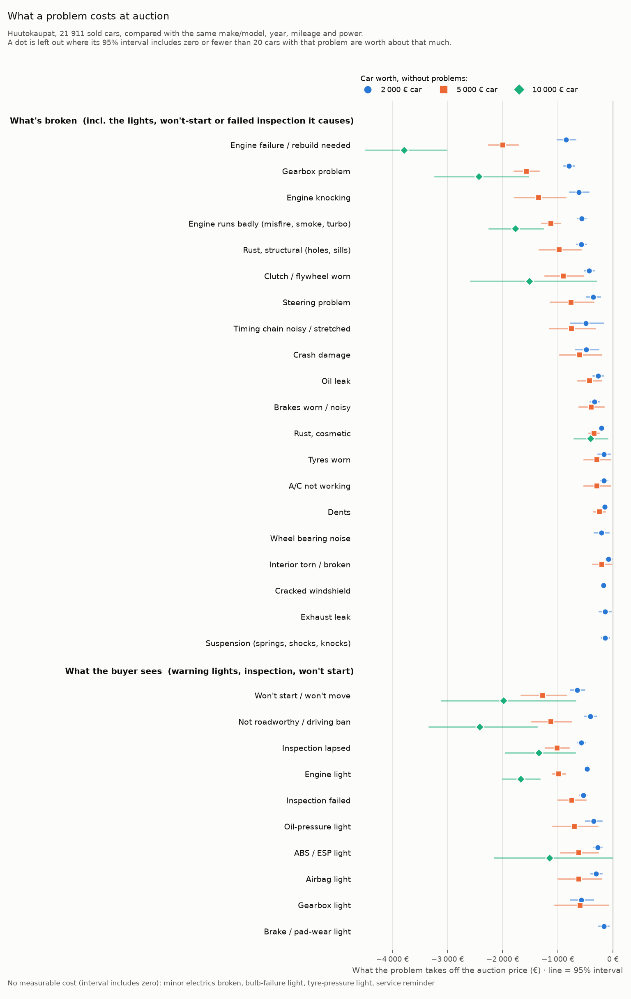
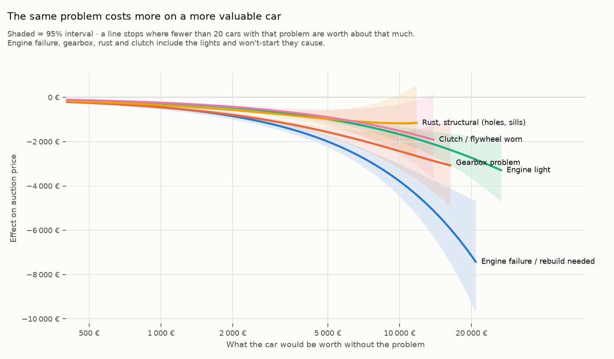

# How much do specific problems lower a used car's price?

Source: **25 922 sold Huutokaupat passenger-car auctions** (2026-05-05 – 2026-10-21); analysis sample **21 911 cars** across 1 085 make×model variants (auctions with at least one bid and a final bid ≥ 100 €; model years 1990+). Median price 2 020 €.

**Headline.** On a car that would be worth 2 000 € without problems, a failed engine takes **−850 €** off the auction price, a gearbox problem **−795 €**, structural rust **−573 €** and an engine warning light **−466 €**. On a 5 000 € car the same problems cost −1 996 €, −1 570 €, −973 € and −979 €.

## How to read the numbers

Every number compares a car that has the problem with otherwise comparable cars that don't — same make×model, model year, mileage, engine power, fuel, gearbox, drive and auction month.

- **What's broken** (engine, gearbox, rust, clutch, …) is valued *including what it causes*: a failed engine also brings an engine light, "won't start" or a failed inspection, and those are part of what the failure does to the price. Other, unrelated problems on the same car are held fixed.
- **What the buyer sees** (warning lights, inspection status, won't start) is valued as it is, with whatever else the seller disclosed held fixed — e.g. an engine light whose cause nobody knows.
- **Euros depend on the car's value.** A repair costs roughly the same on a cheap or a dear car, so one percentage can't describe both. Each problem gets one smooth curve: its % effect is allowed to change with the car's value (linearly in log value), estimated on all cars at once. The value is the car's *clean value* — what a LightGBM model, out-of-fold, predicts it would fetch with no problems.
- A figure is shown only where at least 20 cars with that problem are worth about that much (within a factor of two); elsewhere the curve would be guessing. **No measurable cost** means the 95% interval includes zero — or the estimate came out positive, which a fault can't really do: a tyre-pressure or air-suspension light, for example, also tells you the car *has* those systems, and the model doesn't see trim level.

## What a problem costs, by what the car is worth

What's broken (incl. the lights, won't-start or failed inspection it causes) — euros off the auction price, 95% interval in brackets:

| Problem | Cars with it | car worth 1 000 € | car worth 2 000 € | car worth 5 000 € | car worth 10 000 € | car worth 20 000 € |
|---|---|---|---|---|---|---|
| Engine failure / rebuild needed | 167 | **−444 €** [−551, −312] | **−850 €** [−1 004, −673] | **−1 996 €** [−2 250, −1 719] | **−3 787 €** [−4 475, −3 014] | **−7 151 €** [−9 290, −4 586] |
| Gearbox problem | 429 | **−454 €** [−520, −380] | **−795 €** [−884, −700] | **−1 570 €** [−1 787, −1 337] | **−2 429 €** [−3 227, −1 536] | too few cars |
| Engine knocking | 81 | **−340 €** [−478, −166] | **−621 €** [−784, −436] | **−1 346 €** [−1 780, −853] | too few cars | too few cars |
| Engine runs badly (misfire, smoke, turbo) | 776 | **−326 €** [−370, −277] | **−568 €** [−637, −494] | **−1 123 €** [−1 288, −951] | **−1 766 €** [−2 239, −1 264] | **−2 514 €** [−3 986, −906] |
| Timing chain noisy / stretched | 56 | too few cars | **−491 €** [−757, −169] | **−752 €** [−1 147, −318] | too few cars | too few cars |
| Rust, structural (holes, sills) | 377 | **−349 €** [−400, −294] | **−573 €** [−656, −485] | **−973 €** [−1 332, −579] | no measurable cost | too few cars |
| Clutch / flywheel worn | 349 | **−241 €** [−305, −171] | **−430 €** [−515, −340] | **−897 €** [−1 232, −533] | **−1 514 €** [−2 580, −295] | too few cars |
| Steering problem | 204 | **−199 €** [−286, −101] | **−358 €** [−479, −227] | **−759 €** [−1 133, −348] | no measurable cost | too few cars |
| Crash damage | 177 | **−323 €** [−453, −162] | **−484 €** [−680, −259] | **−600 €** [−960, −207] | no measurable cost | no measurable cost |
| Brakes worn / noisy | 434 | **−228 €** [−285, −166] | **−333 €** [−411, −252] | **−391 €** [−607, −164] | no measurable cost | no measurable cost |
| A/C not working | 827 | **−99 €** [−143, −53] | **−163 €** [−225, −99] | **−288 €** [−520, −43] | no measurable cost | too few cars |
| Rust, cosmetic | 6 540 | **−132 €** [−154, −109] | **−211 €** [−240, −181] | **−344 €** [−435, −252] | **−402 €** [−698, −97] | no measurable cost |
| Dents | 3 070 | **−92 €** [−121, −62] | **−147 €** [−184, −110] | **−245 €** [−343, −144] | no measurable cost | no measurable cost |
| Cracked windshield | 2 978 | **−125 €** [−153, −96] | **−168 €** [−207, −127] | no measurable cost | no measurable cost | no measurable cost |
| Suspension (springs, shocks, knocks) | 600 | **−97 €** [−150, −40] | **−140 €** [−210, −68] | no measurable cost | no measurable cost | too few cars |
| Wheel bearing noise | 141 | no measurable cost | **−208 €** [−335, −70] | no measurable cost | too few cars | too few cars |
| Oil leak | 429 | **−170 €** [−234, −100] | **−269 €** [−355, −178] | **−426 €** [−633, −210] | no measurable cost | too few cars |
| Tyres worn | 329 | **−99 €** [−180, −10] | **−163 €** [−266, −55] | **−288 €** [−523, −40] | no measurable cost | too few cars |
| Exhaust leak | 275 | **−112 €** [−181, −38] | **−143 €** [−245, −35] | no measurable cost | too few cars | too few cars |
| Interior torn / broken | 1 464 | no measurable cost | **−78 €** [−131, −24] | **−197 €** [−365, −22] | no measurable cost | no measurable cost |
| Minor electrics broken | 1 066 | no measurable cost | no measurable cost | no measurable cost | no measurable cost | no measurable cost |

What the buyer sees:

| Problem | Cars with it | car worth 1 000 € | car worth 2 000 € | car worth 5 000 € | car worth 10 000 € | car worth 20 000 € |
|---|---|---|---|---|---|---|
| Any warning light | 5 424 | **−258 €** [−277, −239] | **−426 €** [−451, −399] | **−743 €** [−832, −652] | **−967 €** [−1 263, −660] | no measurable cost |
| Won't start / won't move | 216 | **−371 €** [−445, −286] | **−646 €** [−766, −515] | **−1 272 €** [−1 659, −841] | **−1 980 €** [−3 103, −674] | too few cars |
| Not roadworthy / driving ban | 966 | **−187 €** [−251, −118] | **−408 €** [−513, −296] | **−1 128 €** [−1 469, −754] | **−2 415 €** [−3 328, −1 378] | **−5 143 €** [−7 458, −2 401] |
| Inspection lapsed | 1 005 | **−343 €** [−379, −305] | **−573 €** [−635, −508] | **−1 016 €** [−1 221, −799] | **−1 338 €** [−1 942, −688] | no measurable cost |
| Inspection failed | 653 | **−348 €** [−387, −307] | **−538 €** [−596, −477] | **−746 €** [−988, −489] | no measurable cost | too few cars |
| Engine light | 2 321 | **−260 €** [−285, −233] | **−466 €** [−503, −427] | **−979 €** [−1 090, −866] | **−1 667 €** [−1 997, −1 323] | **−2 729 €** [−3 669, −1 735] |
| Oil-pressure light | 155 | **−200 €** [−303, −83] | **−350 €** [−488, −199] | **−698 €** [−1 083, −274] | no measurable cost | too few cars |
| Gearbox light | 104 | **−392 €** [−518, −234] | **−574 €** [−764, −354] | **−593 €** [−1 053, −78] | no measurable cost | too few cars |
| ABS / ESP light | 578 | **−145 €** [−197, −90] | **−272 €** [−343, −198] | **−619 €** [−944, −268] | **−1 145 €** [−2 146, −17] | too few cars |
| Airbag light | 319 | **−172 €** [−233, −106] | **−303 €** [−397, −204] | **−618 €** [−994, −208] | no measurable cost | too few cars |
| Brake / pad-wear light | 454 | **−124 €** [−191, −51] | **−166 €** [−253, −74] | no measurable cost | no measurable cost | too few cars |
| Bulb-failure light | 868 | no measurable cost | no measurable cost | no measurable cost | no measurable cost | too few cars |
| Tyre-pressure light | 314 | no measurable cost | no measurable cost | no measurable cost | no measurable cost | no measurable cost |
| Service reminder | 358 | **−73 €** [−139, −3] | no measurable cost | no measurable cost | no measurable cost | too few cars |

## Which warning light matters

| Light | Cars | Effect | ≈ € on a 2 000 € car |
|---|---|---|---|
| Engine light | 2 299 | **−23.7%** [−25.7, −21.6] | **−466 €** [−503, −427] |
| Light, type not stated | 1 044 | **−13.8%** [−17.5, −10.0] | **−308 €** [−383, −230] |
| Bulb-failure light | 861 | no measurable effect [−6.1, +0.9] | no measurable cost |
| ABS / ESP light | 574 | **−14.5%** [−18.7, −10.2] | **−272 €** [−343, −198] |
| Brake / pad-wear light | 446 | **−7.1%** [−11.5, −2.4] | **−166 €** [−253, −74] |
| Service reminder | 354 | no measurable effect [−9.2, +1.2] | no measurable cost |
| Airbag light | 314 | **−14.7%** [−20.0, −9.2] | **−303 €** [−397, −204] |
| Tyre-pressure light | 307 | no measurable effect [−1.3, +9.0] | no measurable cost |
| Oil-pressure light | 154 | **−17.9%** [−25.3, −9.7] | **−350 €** [−488, −199] |
| DPF light | 138 | no measurable effect [−16.0, +2.5] | no measurable cost |
| Glow-plug light | 124 | no measurable effect [−10.1, +6.6] | no measurable cost |
| Battery / charging light | 108 | no measurable effect [−4.3, +13.9] | no measurable cost |
| Gearbox light | 102 | **−16.9%** [−28.3, −3.6] | **−574 €** [−764, −354] |
| Coolant light | 91 | no measurable effect [−23.2, +1.7] | no measurable cost |
| light_suspension | 91 | no measurable effect [−5.6, +13.8] | no measurable cost |
| light_steering | 61 | no measurable effect [−14.8, +8.1] | **−198 €** [−366, −13] |
| light_emissions | 60 | no measurable effect [−14.2, +20.9] | no measurable cost |

## All problems, pooled over all cars (%)

One % per problem from the same hedonic model (log price, make×model fixed effects; 95% CIs use the larger of make×model-clustered and heteroskedasticity-robust standard errors). **Effect** = incl. consequences for what's broken, as seen for what the buyer sees. *Alone* = the problem with every other disclosed flag held fixed (smaller for broken parts, because their consequences are then held fixed too). LightGBM = out-of-bag counterfactual of the alone-effect (30 bootstrap refits). Matched = same make×model, year, fuel, gearbox and 50 000 km band; cars whose only major problem is this one vs. cars with none.

| Problem | Cars | Effect | Alone | LightGBM | Matched |
|---|---|---|---|---|---|
| Engine failure / rebuild needed | 167 | **−42.5%** [−47.8, −36.7] | −24.7% [−32.4, −16.2] | −20.8% [−24.0, −17.6] | too few |
| Gearbox problem | 426 | **−38.8%** [−43.0, −34.3] | −33.1% [−37.6, −28.3] | −26.8% [−29.3, −23.0] | −49.6% (n=60) |
| Engine knocking | 81 | **−31.6%** [−38.8, −23.7] | −29.6% [−36.8, −21.5] | −19.4% [−28.3, −9.7] | too few |
| Engine runs badly (misfire, smoke, turbo) | 764 | **−28.0%** [−31.6, −24.2] | −20.6% [−24.3, −16.9] | −17.8% [−20.0, −15.6] | −31.7% (n=103) |
| Timing chain noisy / stretched | 56 | **−17.4%** [−27.1, −6.4] | −13.6% [−24.7, −1.0] | −11.1% [−18.3, −2.6] | too few |
| Rust, structural (holes, sills) | 374 | **−32.4%** [−36.6, −27.9] | −24.8% [−29.2, −20.1] | −17.5% [−21.0, −15.0] | −24.9% (n=51) |
| Clutch / flywheel worn | 346 | **−22.6%** [−27.3, −17.7] | −19.9% [−24.3, −15.2] | −16.4% [−19.6, −13.4] | −12.2% (n=78) |
| Steering problem | 201 | **−16.5%** [−22.9, −9.5] | −15.2% [−21.5, −8.3] | −8.9% [−13.5, −2.7] | −1.3% (n=92) |
| Crash damage | 172 | **−14.4%** [−25.5, −1.6] | −9.1% [−19.4, +2.4] | −9.1% [−12.3, −3.0] | too few |
| Brakes worn / noisy | 430 | **−16.0%** [−20.1, −11.7] | −8.1% [−12.9, −3.0] | −7.0% [−12.4, −3.7] | −4.9% (n=145) |
| A/C not working | 817 | **−9.1%** [−12.4, −5.6] | −9.2% [−12.5, −5.9] | −7.6% [−9.3, −4.8] | −2.5% (n=453) |
| Rust, cosmetic | 6 482 | **−11.1%** [−12.8, −9.3] | −6.7% [−8.4, −4.9] | −5.7% [−6.9, −4.4] | −1.3% (n=3 277) |
| Dents | 3 032 | **−7.1%** [−9.0, −5.1] | −4.9% [−6.7, −3.0] | −5.0% [−6.0, −3.2] | −2.2% (n=1 519) |
| Cracked windshield | 2 933 | **−9.4%** [−11.4, −7.2] | −6.3% [−8.3, −4.3] | −4.7% [−6.4, −3.5] | −6.9% (n=635) |
| Suspension (springs, shocks, knocks) | 597 | **−7.5%** [−11.4, −3.4] | −4.5% [−8.5, −0.3] | −4.1% [−6.2, −2.3] | −3.8% (n=279) |
| Wheel bearing noise | 141 | **−10.0%** [−16.6, −2.8] | −8.9% [−15.5, −1.7] | −5.5% [−10.7, −2.5] | −2.4% (n=68) |
| Oil leak | 419 | **−9.1%** [−13.7, −4.3] | −2.9% [−7.9, +2.4] | −7.2% [−9.3, −4.6] | −4.3% (n=176) |
| Tyres worn | 323 | **−6.8%** [−11.8, −1.5] | −5.3% [−10.3, −0.1] | −4.4% [−8.2, −1.0] | −2.5% (n=177) |
| Exhaust leak | 270 | **−9.5%** [−15.1, −3.5] | −5.8% [−11.4, +0.1] | −3.6% [−7.8, −0.2] | −1.4% (n=132) |
| Interior torn / broken | 1 448 | ≈0 [−5.4, +0.7] | −1.0% [−3.8, +1.9] | −1.3% [−3.1, +0.2] | −1.2% (n=698) |
| Minor electrics broken | 1 053 | ≈0 [−5.4, +1.1] | +0.4% [−2.5, +3.4] | −0.9% [−2.5, +0.4] | −1.8% (n=500) |
| Any warning light | 5 365 | **−18.6%** [−20.1, −17.1] |  | −17.9% [−18.7, −16.9] | −18.8% (n=1 144) |
| Won't start / won't move | 215 | **−30.9%** [−37.5, −23.6] |  | −26.9% [−32.7, −22.7] | too few |
| Not roadworthy / driving ban | 941 | **−23.4%** [−28.5, −17.9] |  | −13.2% [−16.8, −10.6] | +13.6% (n=64) |
| Inspection lapsed | 980 | **−29.8%** [−33.4, −26.0] |  | −28.3% [−30.4, −26.6] | −33.5% (n=116) |
| Inspection failed | 646 | **−29.1%** [−32.3, −25.7] |  | −26.4% [−29.0, −23.3] | −33.5% (n=104) |
| Engine light | 2 299 | **−23.7%** [−25.7, −21.6] |  | −22.1% [−23.7, −20.5] | −21.3% (n=356) |
| Oil-pressure light | 154 | **−17.9%** [−25.3, −9.7] |  | −13.9% [−20.3, −7.7] | too few |
| Gearbox light | 102 | **−16.9%** [−28.3, −3.6] |  | −15.4% [−20.8, −9.1] | too few |
| ABS / ESP light | 574 | **−14.5%** [−18.7, −10.2] |  | −12.7% [−15.5, −10.8] | −23.3% (n=62) |
| Airbag light | 314 | **−14.7%** [−20.0, −9.2] |  | −10.4% [−15.1, −6.4] | −3.0% (n=44) |
| Brake / pad-wear light | 446 | **−7.1%** [−11.5, −2.4] |  | −4.9% [−7.5, −2.6] | −15.4% (n=59) |
| Bulb-failure light | 861 | ≈0 [−6.1, +0.9] |  | −1.5% [−3.6, −0.1] | +2.8% (n=235) |
| Tyre-pressure light | 307 | ≈0 [−1.3, +9.0] |  | −0.5% [−2.5, +0.5] | −0.2% (n=78) |
| Service reminder | 354 | ≈0 [−9.2, +1.2] |  | −2.3% [−4.0, −0.1] | −10.5% (n=67) |

## Per make / model (largest models)

% effects with the problem's other disclosed flags held fixed, from one model with problem×model interactions and **shrunk toward the all-cars effect** (empirical Bayes) because single-model estimates are noisy. `too few` = under 15 cars with that problem in that model (count in brackets). Raw estimates with CIs: `effects_by_segment.csv`.

| Model | Cars | any light | engine light | rust (struct.) | rust (cosm.) | windshield | insp. lapsed | not roadworthy | gearbox | clutch | engine failure |
|---|---|---|---|---|---|---|---|---|---|---|---|
| Volkswagen Golf | 922 | −23.1% (287) | −27.6% (130) | −24.8% (20) | −10.1% (449) | −5.8% (118) | −35.7% (58) | −23.4% (38) | −31.2% (28) | −23.9% (23) | too few (5) |
| Škoda Octavia | 759 | −18.7% (308) | −24.8% (95) | −24.8% (23) | −6.3% (360) | −8.8% (93) | −49.0% (36) | −23.4% (26) | −35.1% (17) | too few (8) | too few (1) |
| Ford Focus | 630 | −24.6% (98) | −24.9% (50) | too few (10) | −5.0% (230) | −4.7% (72) | −41.7% (28) | too few (12) | too few (13) | too few (8) | too few (3) |
| Volkswagen Passat | 587 | −20.7% (183) | −23.0% (69) | too few (12) | −11.3% (275) | −6.4% (84) | −36.9% (21) | −23.4% (24) | too few (12) | −19.1% (16) | too few (3) |
| Audi A4 | 574 | −17.7% (160) | −20.7% (72) | too few (12) | −7.8% (239) | −2.7% (106) | −21.5% (19) | −23.4% (40) | −33.8% (17) | too few (6) | too few (6) |
| Mercedes-Benz C-Class | 543 | −17.4% (155) | −23.5% (71) | too few (4) | −8.0% (127) | −5.0% (81) | −13.1% (29) | −23.4% (43) | too few (10) | too few (1) | too few (10) |
| Volvo V70 | 496 | −19.2% (173) | −21.5% (64) | too few (14) | −6.3% (162) | −11.4% (60) | −40.3% (21) | −23.4% (22) | too few (9) | too few (2) | too few (2) |
| Mercedes-Benz E-Class | 490 | −11.9% (159) | −21.5% (51) | too few (6) | −4.0% (113) | −4.9% (75) | +5.1% (18) | −23.4% (52) | too few (9) | too few (0) | too few (4) |
| Toyota Corolla | 449 | −16.1% (51) | −20.3% (32) | too few (12) | −4.2% (139) | −4.4% (94) | −14.8% (17) | −23.4% (17) | too few (8) | −17.0% (24) | too few (0) |
| BMW 3 Serie | 446 | −14.5% (161) | −23.5% (51) | too few (6) | −1.4% (93) | −3.7% (67) | −23.9% (31) | −23.4% (43) | too few (4) | too few (2) | too few (6) |
| BMW 5 Serie | 432 | −6.5% (133) | −23.3% (38) | too few (0) | −5.3% (70) | +1.8% (61) | −18.1% (26) | −23.4% (64) | too few (4) | too few (1) | too few (8) |
| Toyota Avensis | 408 | −17.2% (62) | −19.2% (38) | too few (4) | −2.5% (91) | −6.9% (86) | −36.0% (22) | too few (11) | too few (5) | too few (10) | too few (0) |
| Ford Mondeo | 396 | −18.6% (60) | −25.7% (31) | too few (4) | −8.5% (105) | −4.0% (58) | −43.7% (18) | too few (7) | too few (12) | too few (8) | too few (2) |
| Opel Astra | 372 | −16.1% (90) | −21.4% (50) | too few (7) | −6.2% (118) | −7.6% (37) | −44.3% (19) | too few (12) | too few (7) | too few (1) | too few (1) |
| Audi A6 | 342 | −18.1% (118) | −16.0% (53) | too few (6) | −7.3% (120) | −7.3% (44) | −36.5% (25) | −23.4% (28) | too few (9) | too few (2) | too few (5) |
| Nissan Qashqai | 329 | −17.9% (63) | −20.3% (40) | too few (1) | −5.0% (27) | +2.6% (38) | too few (7) | too few (13) | −33.4% (25) | too few (5) | too few (12) |
| Toyota Yaris | 282 | −20.8% (40) | −22.5% (34) | too few (8) | −6.3% (85) | −8.9% (38) | too few (9) | too few (8) | too few (7) | too few (12) | too few (0) |
| Volvo V50 | 267 | −19.8% (65) | −26.9% (34) | too few (3) | −8.0% (108) | −7.8% (53) | too few (14) | too few (9) | too few (7) | too few (5) | too few (0) |

## Robustness

The *alone* % effect re-estimated on different samples / fixed effects. If a number moves a lot here, don't quote it.

| Problem | >= 10 bids | accepted sales only | dealer-style listings only | main (all auctions with >=1 bid, price >= 100 €) | model-generation FE | price >= 500 € | private-style listings only |
|---|---|---|---|---|---|---|---|
| Any warning light | −17.3% | −18.3% | −17.5% | −18.6% | −18.2% | −15.3% | −20.8% |
| Engine light | −23.0% | −24.0% | −23.3% | −23.7% | −23.3% | −19.8% | −24.5% |
| Timing belt due / unknown | +3.1% | −1.2% | +5.1% | +5.9% | +0.5% | +6.1% | too few |
| Gearbox problem | −32.5% | −35.0% | −32.5% | −34.6% | −34.1% | −27.2% | −36.7% |
| Clutch / flywheel worn | −17.9% | −24.2% | −21.5% | −20.2% | −20.1% | −14.3% | −13.2% |
| Engine failure / rebuild needed | −29.6% | −25.2% | −30.0% | −27.6% | −28.0% | −28.0% | −27.6% |
| Engine knocking | −24.2% | −28.3% | −28.4% | −28.7% | −30.1% | −25.0% | too few |
| Won't start / won't move | −25.4% | −30.6% | −31.9% | −31.0% | −30.5% | −23.7% | −31.0% |
| Rust, structural (holes, sills) | −23.9% | −24.3% | −23.0% | −24.7% | −22.3% | −15.5% | −30.1% |
| Crash damage | +0.7% | +2.5% | −2.1% | −8.0% | −11.9% | +0.1% | −12.2% |
| Inspection failed | −25.7% | −28.6% | −26.4% | −28.9% | −28.6% | −18.0% | −30.3% |
| Cracked windshield | −6.4% | −6.7% | −6.6% | −6.4% | −4.6% | −4.9% | −5.4% |

## Out-of-sample fit (5-fold CV)

Predicting log(price) of held-out auctions; the gain from adding the problem flags is measured out of sample.

| model | features | R² (log price) | MAE (log) | Median abs. % error |
|---|---|---|---|---|
| hedonic OLS | without fault flags | 0.721 | 0.402 | 29.5% |
| LightGBM | without fault flags | 0.762 | 0.361 | 25.5% |
| hedonic OLS | with fault flags | 0.775 | 0.358 | 26.4% |
| LightGBM | with fault flags | 0.818 | 0.314 | 22.2% |

## How good are the problem flags?

Rules were checked by hand on fresh random samples drawn *after* each rule's last change (a first development round only fixed rules). Precision = share of flagged listings that really have the problem (20 checked). Recall is estimated from 15 unflagged listings that mention the topic's keyword stem, so its interval is wide. Missed problems sit in the comparison group and pull effects **toward zero**. After the last check, a few fixes only *removed* matches (negations such as 'ruoste ei ole mennyt läpi', a cracked rear window, ad wording like 'xenon-ajovalot'), so for structural rust, windshield and light types the precision shown is a lower bound.

| Flag | n flagged | Precision | Recall (est.) |
|---|---|---|---|
| Engine / check-engine light | 2 211 | 100% [84%, 100%] | 100% [99%, 100%] |
| ABS / ESP / traction-control light | 556 | 95% [76%, 99%] | 100% [100%, 100%] |
| Airbag (SRS) light | 308 | 95% [76%, 99%] | ≈100% (no unflagged mentions) |
| DPF (particulate filter) light | 130 | 100% [84%, 100%] | ≈100% (no unflagged mentions) |
| Glow-plug light | 117 | 100% [84%, 100%] | ≈100% (no unflagged mentions) |
| Timing belt due / unknown | 77 | 100% [84%, 100%] | 62% [27%, 90%] |
| Gearbox problem | 435 | 95% [76%, 99%] | 68% [32%, 92%] |
| Clutch / flywheel worn | 353 | 100% [84%, 100%] | 57% [37%, 79%] |
| Engine damage, any (failure or knock) | 245 | 95% [76%, 99%] | 100% [22%, 100%] |
| Won't start / won't move | 217 | 100% [84%, 100%] | 100% [37%, 100%] |
| Crash / collision damage | 179 | 90% [70%, 97%] | 99% [96%, 100%] |
| Rust (any) | 7 026 | 100% [84%, 100%] | 100% [97%, 100%] |
| Rust, structural / holes / sills | 385 | 85% [64%, 95%] | 100% [17%, 100%] |
| Windshield cracked | 3 009 | 100% [84%, 100%] | 100% [80%, 100%] |
| Inspection failed (hylätty) | 661 | 95% [76%, 99%] | 100% [81%, 100%] |

## Cross-check on Nettiauto asking prices

540 private-seller listings under 5 000 € (the watcher's saved search), problems from the free-text description only. Asking prices, not sale prices; small sample — indicative only. *Alone* % effects.

| Problem | Listings with it | Effect |
|---|---|---|
| Any warning light | 22 | too few |
| Not roadworthy / driving ban | 37 | −46.2% [−58.9, −29.6] |
| Inspection lapsed | 29 | too few |
| Rust, cosmetic | 72 | −13.3% [−21.0, −4.8] |
| Rust, structural (holes, sills) | 2 | too few |
| Cracked windshield | 18 | too few |
| Sold as project / for parts | 25 | too few |

## What this is not

- **Not repair quotes.** An effect is how much less bidders paid for cars that disclosed the problem than for comparable cars that didn't. It mixes the expected repair cost with risk (an unknown cause behind an engine light) and anything else that goes with disclosing it.
- **Disclosure-based.** Problems are what sellers wrote. The 'is any warning light on?' checklist question is asked of every seller, so the light results are the cleanest; free-text problems depend on how carefully a seller writes, and missed mentions make effects look smaller.
- **Auction market, mostly cheap cars.** Huutokaupat buyers are bargain hunters and traders, and few cars here are worth over 10 000 €, so the top of every curve is thin.
- **Controls, not problems.** Import, one key, no service book, tyres and 'emissions system modified' are held fixed as car attributes; their coefficients say which kinds of cars carry them.
