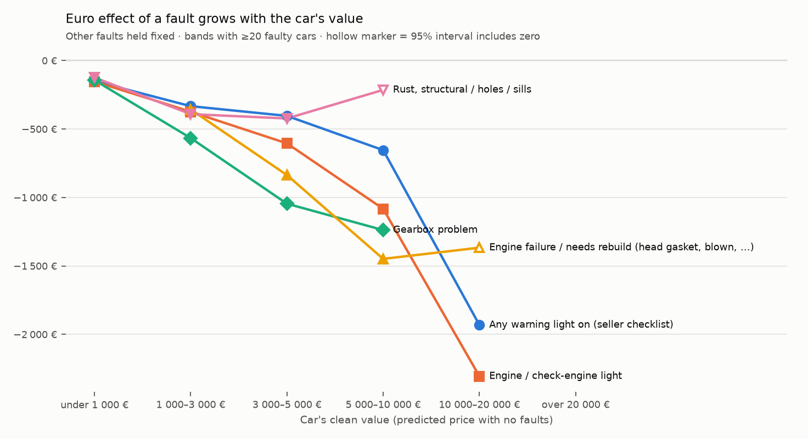
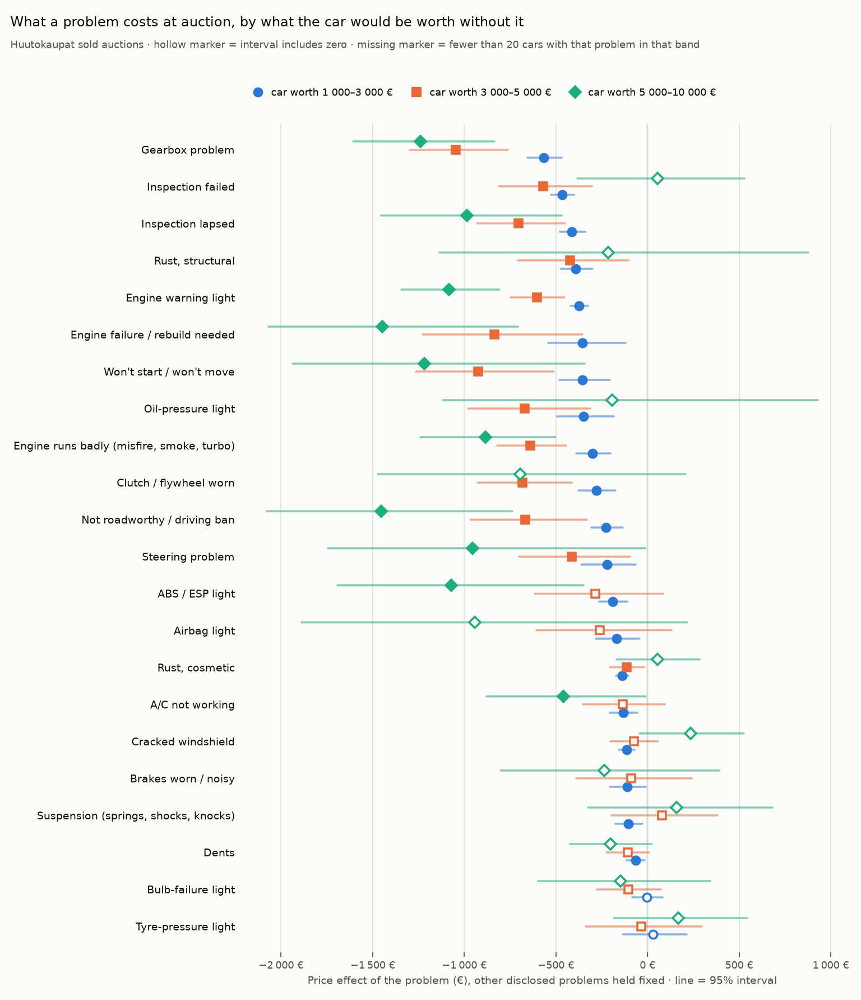
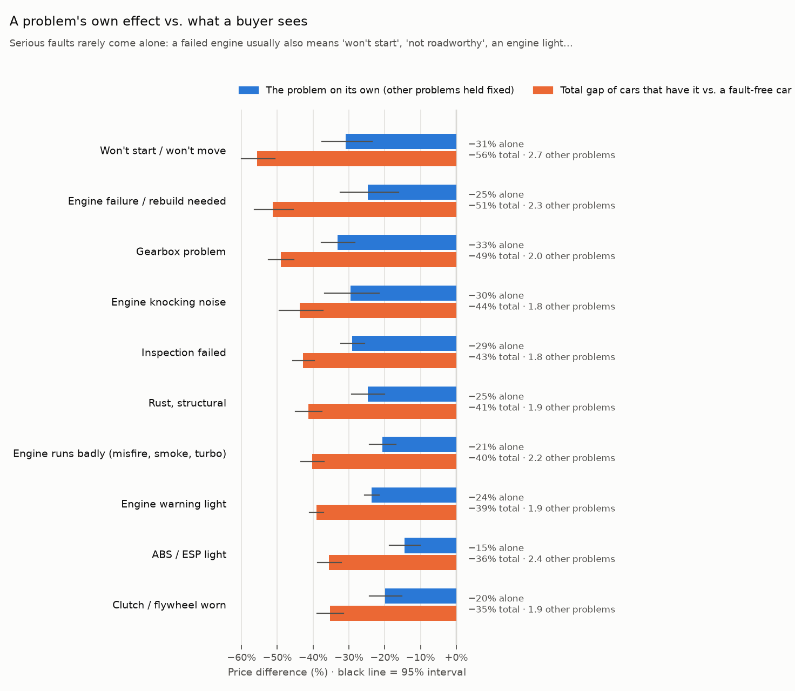
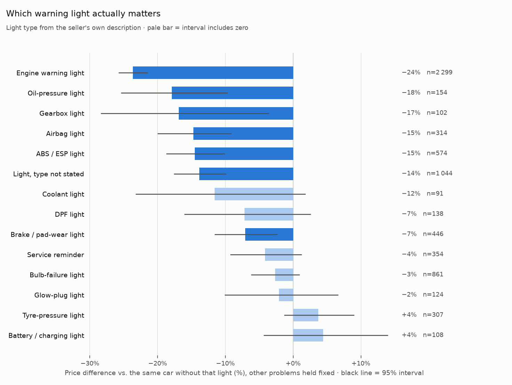
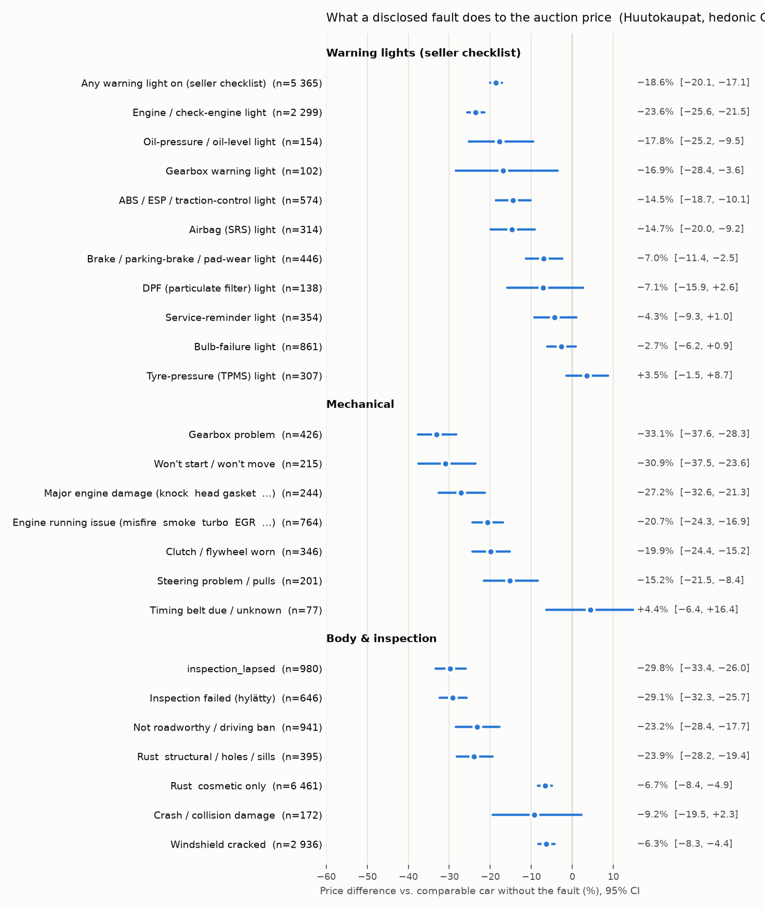
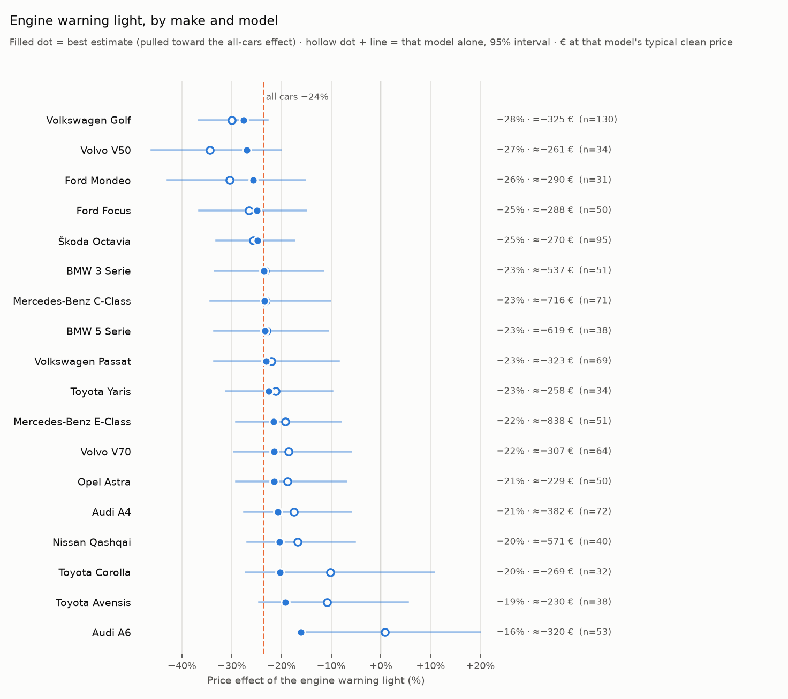

# How much do specific faults lower a used car's price?

Source: **25 922 sold Huutokaupat passenger-car auctions** (2026-05-05 – 2026-10-21); analysis sample **21 911 cars** across 1 085 make×model variants (auctions with at least one bid and a final bid ≥ 100 €; model years 1990+). Median price 2 020 €; 44% of auctions ended with the seller accepting the top bid (the rest still give the market's top bid).

**Headline.** A warning light on the seller's checklist costs more euros on a more valuable car but a smaller share of its price. By the car's clean value: under 1 000 €: **−150 €** (−25.8%, n = 934); 1 000–3 000 €: **−333 €** (−21.2%, n = 2 453); 3 000–5 000 €: **−404 €** (−11.7%, n = 1 062); 5 000–10 000 €: **−654 €** (−10.6%, n = 732); 10 000–20 000 €: **−1 931 €** (−15.2%, n = 168). Pooled over all cars: −18.6% [−20.1, −17.1]. The engine / check-engine light alone: −23.7% [−25.7, −21.6] (n = 2 299).

Every effect compares a car that disclosed the fault with otherwise comparable cars — same make×model, model year, mileage, power, fuel, gearbox, drive and auction month.

## By car value (€)

Cars are banded by their **clean value**: the price LightGBM predicts for that car with every disclosed fault removed, out-of-fold so a car's own sale price doesn't decide its band (banding on the sale price would push faulty cars into cheaper bands). LightGBM rather than the hedonic model because on fault-free cars the hedonic model over-predicts newer, pricier cars by 25–40% in the top bands, while LightGBM's error is flat across bands. The % effects still come from the hedonic model; euros = that % × the car's clean value × its other faults' discount. Cars per band: under 1 000 € 3 573, 1 000–3 000 € 9 450, 3 000–5 000 € 4 513, 5 000–10 000 € 3 386, 10 000–20 000 € 868, over 20 000 € 121. Each cell is the euro effect of that fault with the other disclosed faults held fixed, and the number of faulty cars in the band. **Bold** = the 95% interval excludes zero; `n.s.` = it includes zero (no clear effect — small positive numbers in the upper bands are noise, not faults that raise the price); `n/e` = fewer than 20 faulty cars. Same model as the main table but with every fault interacted with the band.

| Fault | under 1 000 € | 1 000–3 000 € | 3 000–5 000 € | 5 000–10 000 € | 10 000–20 000 € | over 20 000 € |
|---|---|---|---|---|---|---|
| Any warning light on (seller checklist) | **−150 €** (934) | **−333 €** (2 453) | **−404 €** (1 062) | **−654 €** (732) | **−1 931 €** (168) | n/e (16) |
| Engine / check-engine light | **−153 €** (454) | **−373 €** (1 058) | **−605 €** (417) | **−1 083 €** (309) | **−2 306 €** (59) | n/e (2) |
| ABS / ESP / traction-control light | **−77 €** (134) | **−190 €** (295) | −285 € (101, n.s.) | **−1 070 €** (42) | n/e (2) | n/e (0) |
| Airbag (SRS) light | **−121 €** (79) | **−169 €** (156) | −260 € (52, n.s.) | −941 € (22, n.s.) | n/e (4) | n/e (1) |
| Engine failure / needs rebuild (head gasket, blown, …) | n/e (9) | **−357 €** (48) | **−836 €** (36) | **−1 448 €** (50) | −1 366 € (24, n.s.) | n/e (0) |
| Engine knocking noise | n/e (12) | **−392 €** (38) | n/e (18) | n/e (11) | n/e (2) | n/e (0) |
| Gearbox problem | **−143 €** (54) | **−566 €** (170) | **−1 045 €** (110) | **−1 238 €** (80) | n/e (11) | n/e (1) |
| Clutch / flywheel worn | **−144 €** (73) | **−280 €** (177) | **−683 €** (62) | −695 € (30, n.s.) | n/e (4) | n/e (0) |
| Won't start / won't move | **−201 €** (39) | **−354 €** (88) | **−924 €** (41) | **−1 218 €** (36) | n/e (11) | n/e (0) |
| Engine running issue (misfire, smoke, turbo, EGR, …) | **−162 €** (106) | **−300 €** (336) | **−639 €** (157) | **−884 €** (141) | −437 € (23, n.s.) | n/e (1) |
| Not roadworthy / driving ban | **−81 €** (153) | **−225 €** (405) | **−669 €** (148) | **−1 454 €** (189) | **−3 660 €** (42) | n/e (4) |
| Inspection lapsed (not failed) | **−180 €** (232) | **−412 €** (463) | **−703 €** (129) | **−986 €** (120) | +611 € (28, n.s.) | n/e (8) |
| Inspection failed (hylätty) | **−199 €** (171) | **−466 €** (328) | **−569 €** (90) | +56 € (52, n.s.) | n/e (4) | n/e (1) |
| Rust, structural / holes / sills | **−124 €** (118) | **−391 €** (179) | **−423 €** (49) | −214 € (24, n.s.) | n/e (4) | n/e (0) |
| Rust, cosmetic only | **−41 €** (1 406) | **−139 €** (3 265) | **−115 €** (1 218) | +53 € (547, n.s.) | −1 487 € (46, n.s.) | n/e (0) |
| Windshield cracked | **−60 €** (623) | **−114 €** (1 429) | −75 € (524, n.s.) | +234 € (285, n.s.) | +829 € (62, n.s.) | n/e (10) |

95% intervals of the euro effects:

| Fault | under 1 000 € | 1 000–3 000 € | 3 000–5 000 € | 5 000–10 000 € | 10 000–20 000 € | over 20 000 € |
|---|---|---|---|---|---|---|
| Any warning light on (seller checklist) | [−170, −128] | [−365, −300] | [−519, −285] | [−859, −441] | [−2 641, −1 172] | n/e (16) |
| Engine / check-engine light | [−177, −127] | [−418, −326] | [−747, −454] | [−1 343, −807] | [−3 137, −1 392] | n/e (2) |
| ABS / ESP / traction-control light | [−121, −29] | [−264, −111] | [−614, +86] | [−1 691, −349] | n/e (2) | n/e (0) |
| Airbag (SRS) light | [−166, −69] | [−282, −44] | [−606, +132] | [−1 887, +218] | n/e (4) | n/e (1) |
| Engine failure / needs rebuild (head gasket, blown, …) | n/e (9) | [−541, −119] | [−1 227, −354] | [−2 069, −707] | [−2 566, +7] | n/e (0) |
| Engine knocking noise | n/e (12) | [−575, −173] | n/e (18) | n/e (11) | n/e (2) | n/e (0) |
| Gearbox problem | [−208, −62] | [−654, −468] | [−1 296, −764] | [−1 607, −836] | n/e (11) | n/e (1) |
| Clutch / flywheel worn | [−198, −80] | [−378, −174] | [−928, −413] | [−1 472, +208] | n/e (4) | n/e (0) |
| Won't start / won't move | [−251, −139] | [−480, −205] | [−1 264, −513] | [−1 936, −344] | n/e (11) | n/e (0) |
| Engine running issue (misfire, smoke, turbo, EGR, …) | [−200, −119] | [−389, −204] | [−820, −445] | [−1 240, −503] | [−2 009, +1 421] | n/e (1) |
| Not roadworthy / driving ban | [−116, −41] | [−307, −135] | [−964, −331] | [−2 078, −739] | [−5 946, −670] | n/e (4) |
| Inspection lapsed (not failed) | [−205, −153] | [−478, −341] | [−931, −449] | [−1 454, −469] | [−1 215, +2 778] | n/e (8) |
| Inspection failed (hylätty) | [−233, −161] | [−527, −401] | [−812, −302] | [−384, +528] | n/e (4) | n/e (1) |
| Rust, structural / holes / sills | [−168, −73] | [−474, −300] | [−707, −105] | [−1 136, +877] | n/e (4) | n/e (0) |
| Rust, cosmetic only | [−64, −17] | [−173, −104] | [−206, −20] | [−169, +283] | [−3 022, +291] | n/e (0) |
| Windshield cracked | [−83, −36] | [−155, −71] | [−202, +56] | [−44, +524] | [−346, +2 124] | n/e (10) |

The same as a percentage of the car's clean price:

| Fault | under 1 000 € | 1 000–3 000 € | 3 000–5 000 € | 5 000–10 000 € | 10 000–20 000 € | over 20 000 € |
|---|---|---|---|---|---|---|
| Any warning light on (seller checklist) | −25.8% [−29.4, −22.1] | −21.2% [−23.2, −19.1] | −11.7% [−15.0, −8.2] | −10.6% [−13.9, −7.1] | −15.2% [−20.8, −9.2] | n/e (16) |
| Engine / check-engine light | −27.4% [−31.7, −22.8] | −25.0% [−28.0, −21.9] | −18.2% [−22.5, −13.7] | −18.1% [−22.5, −13.5] | −20.0% [−27.2, −12.1] | n/e (2) |
| ABS / ESP / traction-control light | −15.2% [−23.7, −5.7] | −14.3% [−19.9, −8.4] | −8.8% [−19.0, +2.7] | −19.5% [−30.7, −6.3] | n/e (2) | n/e (0) |
| Airbag (SRS) light | −23.2% [−32.1, −13.2] | −12.3% [−20.5, −3.2] | −8.2% [−19.1, +4.2] | −15.5% [−31.2, +3.6] | n/e (4) | n/e (1) |
| Engine failure / needs rebuild (head gasket, blown, …) | n/e (9) | −30.5% [−46.3, −10.1] | −28.8% [−42.2, −12.2] | −27.4% [−39.2, −13.4] | −12.7% [−23.8, +0.1] | n/e (0) |
| Engine knocking noise | n/e (12) | −26.1% [−38.2, −11.5] | n/e (18) | n/e (11) | n/e (2) | n/e (0) |
| Gearbox problem | −29.2% [−42.6, −12.6] | −38.4% [−44.4, −31.8] | −31.3% [−38.8, −22.9] | −21.5% [−27.9, −14.5] | n/e (11) | n/e (1) |
| Clutch / flywheel worn | −26.6% [−36.8, −14.9] | −18.9% [−25.5, −11.7] | −20.4% [−27.8, −12.4] | −11.1% [−23.5, +3.3] | n/e (4) | n/e (0) |
| Won't start / won't move | −40.7% [−51.0, −28.2] | −30.3% [−41.0, −17.5] | −32.1% [−43.9, −17.8] | −23.2% [−36.8, −6.5] | n/e (11) | n/e (0) |
| Engine running issue (misfire, smoke, turbo, EGR, …) | −31.3% [−38.7, −23.0] | −21.3% [−27.6, −14.5] | −19.6% [−25.2, −13.7] | −14.9% [−20.8, −8.4] | −4.1% [−18.9, +13.3] | n/e (1) |
| Not roadworthy / driving ban | −21.8% [−31.3, −11.1] | −21.0% [−28.6, −12.6] | −22.1% [−31.9, −10.9] | −22.9% [−32.7, −11.6] | −27.4% [−44.5, −5.0] | n/e (4) |
| Inspection lapsed (not failed) | −37.3% [−42.4, −31.6] | −32.3% [−37.5, −26.8] | −23.4% [−31.0, −14.9] | −16.5% [−24.3, −7.8] | +5.6% [−11.1, +25.3] | n/e (8) |
| Inspection failed (hylätty) | −36.9% [−43.3, −29.8] | −32.2% [−36.4, −27.7] | −17.4% [−24.8, −9.2] | +0.9% [−6.1, +8.3] | n/e (4) | n/e (1) |
| Rust, structural / holes / sills | −24.7% [−33.5, −14.6] | −28.3% [−34.4, −21.8] | −13.2% [−22.0, −3.3] | −3.5% [−18.3, +14.2] | n/e (4) | n/e (0) |
| Rust, cosmetic only | −7.2% [−11.4, −2.9] | −8.8% [−11.0, −6.6] | −3.3% [−6.0, −0.6] | +0.9% [−2.7, +4.6] | −11.7% [−23.8, +2.3] | n/e (0) |
| Windshield cracked | −10.9% [−15.1, −6.5] | −7.4% [−10.2, −4.6] | −2.2% [−5.9, +1.6] | +3.7% [−0.7, +8.3] | +6.9% [−2.9, +17.8] | n/e (10) |

## Why can a gearbox fault look bigger than engine damage?

Two different questions give two different numbers:

- **This fault, others held fixed** (the main column): how much the fault itself moves the price when everything else the seller disclosed is the same. A car with a failed engine usually *also* gets flagged "won't start", "not roadworthy", "engine light on" or "sold for parts" — those flags take their own share of the discount, so the engine flag's own coefficient is smaller.
- **Total gap of these cars**: the cars that have the fault vs. the same cars with *every* disclosed fault removed — what a buyer actually sees, including whatever usually comes with the fault (and also unrelated faults those cars happen to have, so read it as typical, not causal).

Engine failure: −24.7% on its own, but these cars sell −51.3% (−2 528 €) below a clean car; they carry 2.3 other fault flags on average. Gearbox problem: −33.1% on its own, −49.0% (−1 627 €) in total, 2.0 other flags. Engine knocking noise: −29.6% on its own, −43.7% total. In euros, an engine failure on its own costs about as much as a gearbox problem (−926 € vs −924 €), but together with what usually comes with it much more (−2 528 € vs −1 627 €); it also sits on pricier cars (median clean value 2 506 € vs 2 135 €). The two % effects' intervals overlap ([−32.4, −16.2] vs [−37.6, −28.3]). The earlier single "major engine damage" flag mixed outright failures with mere knocking noises; they are now separate.

## All faults (pooled over all cars)

This fault = hedonic OLS on log(price) with make×model fixed effects; 95% CIs use the larger of make×model-clustered and heteroskedasticity-robust standard errors. ≈ € = that effect on the faulty cars' own value without this fault (LightGBM clean value, their other faults kept). Total gap = see the section above. LightGBM = out-of-bag counterfactual (flag on vs. off), 30 bootstrap refits. Matched = same make×model, year, fuel, gearbox and 50 000 km band; cars whose *only* major fault is this one vs. cars with none. Below 30 faulty cars a row says *not enough data*. A pooled % hides that the euro effect grows with the car's value — use the band tables for euros.

| Fault | n faulty | This fault (others held fixed) | ≈ € | Total gap of these cars | LightGBM | Matched |
|---|---|---|---|---|---|---|
| Any warning light on (seller checklist) | 5 365 | **−18.6%** [−20.1, −17.1] | −506 € [−546, −465] | −31.9% · −937 € | −17.9% [−18.7, −16.9] | −18.8% (n=1 144) |
| Engine / check-engine light | 2 299 | **−23.7%** [−25.7, −21.6] | −574 € [−624, −523] | −39.0% · −1 105 € | −22.1% [−23.7, −20.5] | −21.3% (n=356) |
| ABS / ESP / traction-control light | 574 | **−14.5%** [−18.7, −10.2] | −257 € [−331, −180] | −35.6% · −741 € | −12.7% [−15.5, −10.8] | −23.3% (n=62) |
| Airbag (SRS) light | 314 | **−14.7%** [−20.0, −9.2] | −284 € [−385, −177] | −33.7% · −730 € | −10.4% [−15.1, −6.4] | −3.0% (n=44) |
| Oil-pressure / oil-level light | 154 | **−17.9%** [−25.3, −9.7] | −422 € [−597, −230] | −39.9% · −1 259 € | −13.9% [−20.3, −7.7] | n/e (n=20) |
| Gearbox warning light | 102 | **−16.9%** [−28.3, −3.6] | −370 € [−621, −79] | −51.0% · −1 794 € | −15.4% [−20.8, −9.1] | n/e (n=8) |
| Brake / parking-brake / pad-wear light | 446 | **−7.1%** [−11.5, −2.4] | −175 € [−285, −59] | −28.8% · −725 € | −4.9% [−7.5, −2.6] | −15.4% (n=59) |
| Coolant / temperature light | 91 | **−11.6%** [−23.2, +1.7] | −226 € [−453, +34] | −33.9% · −910 € | −7.7% [−14.2, −0.6] | n/e (n=12) |
| DPF (particulate filter) light | 138 | **−7.2%** [−16.0, +2.5] | −159 € [−354, +56] | −34.4% · −977 € | −3.5% [−8.8, −0.1] | n/e (n=5) |
| Glow-plug light | 124 | **−2.1%** [−10.1, +6.6] | −42 € [−202, +132] | −33.6% · −830 € | −5.1% [−9.3, −0.0] | n/e (n=8) |
| Tyre-pressure (TPMS) light | 307 | **+3.7%** [−1.3, +9.0] | +169 € [−59, +408] | −14.2% · −535 € | −0.5% [−2.5, +0.5] | −0.2% (n=78) |
| Service-reminder light | 354 | **−4.2%** [−9.2, +1.2] | −95 € [−212, +27] | −25.7% · −632 € | −2.3% [−4.0, −0.1] | −10.5% (n=67) |
| Bulb-failure light | 861 | **−2.7%** [−6.1, +0.9] | −61 € [−140, +20] | −20.9% · −463 € | −1.5% [−3.6, −0.1] | +2.8% (n=235) |
| Warning light, type not stated | 1 044 | **−13.8%** [−17.5, −10.0] | −480 € [−608, −346] | −26.1% · −916 € | −10.7% [−12.6, −9.1] | −16.2% (n=264) |
| Engine failure / needs rebuild (head gasket, blown, …) | 167 | **−24.7%** [−32.4, −16.2] | −926 € [−1 214, −606] | −51.3% · −2 528 € | −20.8% [−24.0, −17.6] | n/e (n=14) |
| Engine knocking noise | 81 | **−29.6%** [−36.8, −21.5] | −772 € [−962, −561] | −43.7% · −1 249 € | −19.4% [−28.3, −9.7] | n/e (n=17) |
| Gearbox problem | 426 | **−33.1%** [−37.6, −28.3] | −924 € [−1 050, −790] | −49.0% · −1 627 € | −26.8% [−29.3, −23.0] | −49.6% (n=60) |
| Won't start / won't move | 215 | **−30.9%** [−37.5, −23.6] | −725 € [−881, −553] | −55.6% · −1 912 € | −26.9% [−32.7, −22.7] | n/e (n=15) |
| Clutch / flywheel worn | 346 | **−19.9%** [−24.3, −15.2] | −409 € [−501, −313] | −35.3% · −831 € | −16.4% [−19.6, −13.4] | −12.2% (n=78) |
| Engine running issue (misfire, smoke, turbo, EGR, …) | 764 | **−20.6%** [−24.3, −16.9] | −551 € [−647, −450] | −40.3% · −1 271 € | −17.8% [−20.0, −15.6] | −31.7% (n=103) |
| Timing belt due / unknown | 77 | **+4.4%** [−6.5, +16.6] | +145 € [−211, +542] | −10.5% · −252 € | −1.5% [−9.5, +6.7] | n/e (n=14) |
| Timing-chain noise / stretched | 56 | **−13.6%** [−24.7, −1.0] | −556 € [−1 007, −39] | −28.9% · −1 949 € | −11.1% [−18.3, −2.6] | n/e (n=29) |
| Steering problem / pulls | 201 | **−15.2%** [−21.5, −8.3] | −362 € [−512, −199] | −31.2% · −797 € | −8.9% [−13.5, −2.7] | −1.3% (n=92) |
| Not roadworthy / driving ban | 941 | **−23.4%** [−28.5, −17.9] | −630 € [−768, −482] | −48.5% · −1 523 € | −13.2% [−16.8, −10.6] | +13.6% (n=64) |
| Inspection lapsed (not failed) | 980 | **−29.8%** [−33.4, −26.0] | −663 € [−743, −578] | −48.8% · −1 389 € | −28.3% [−30.4, −26.6] | −33.5% (n=116) |
| Inspection failed (hylätty) | 646 | **−29.1%** [−32.3, −25.7] | −546 € [−607, −483] | −42.8% · −950 € | −26.4% [−29.0, −23.3] | −33.5% (n=104) |
| Rust, structural / holes / sills | 374 | **−24.8%** [−29.2, −20.1] | −428 € [−504, −347] | −41.3% · −813 € | −17.5% [−21.0, −15.0] | −24.9% (n=51) |
| Rust, cosmetic only | 6 482 | **−6.7%** [−8.4, −4.9] | −143 € [−179, −106] | −20.9% · −449 € | −5.7% [−6.9, −4.4] | −1.3% (n=3 277) |
| Crash / collision damage | 172 | **−9.1%** [−19.4, +2.4] | −463 € [−981, +121] | −23.2% · −882 € | −9.1% [−12.3, −3.0] | n/e (n=24) |
| Windshield cracked | 2 933 | **−6.3%** [−8.3, −4.3] | −149 € [−195, −102] | −22.8% · −543 € | −4.7% [−6.4, −3.5] | −6.9% (n=635) |
| A/C not working properly | 817 | **−9.2%** [−12.5, −5.9] | −204 € [−277, −130] | −23.4% · −500 € | −7.6% [−9.3, −4.8] | −2.5% (n=453) |
| Sold as project / for parts / to repair | 295 | **−14.9%** [−21.2, −8.0] | −387 € [−554, −207] | −45.0% · −1 716 € | −15.4% [−18.7, −10.8] | −35.3% (n=30) |

### Per make / model (largest segments)

Segment-specific % effects from the OLS with fault×segment interactions, shown **shrunk toward the overall effect** (empirical Bayes) because single-segment estimates are noisy; raw estimates and CIs are in `effects_by_segment.csv`. `n/e` = fewer than 15 faulty cars in that segment (count in brackets).

| Segment | n | any light | engine light | rust (struct.) | rust (cosm.) | windshield | insp. lapsed | not roadworthy | gearbox | clutch | engine failure |
|---|---|---|---|---|---|---|---|---|---|---|---|
| Volkswagen Golf | 922 | −23.1% (287) | −27.6% (130) | −24.8% (20) | −10.1% (449) | −5.8% (118) | −35.7% (58) | −23.4% (38) | −31.2% (28) | −23.9% (23) | n/e (5) |
| Škoda Octavia | 759 | −18.7% (308) | −24.8% (95) | −24.8% (23) | −6.3% (360) | −8.8% (93) | −49.0% (36) | −23.4% (26) | −35.1% (17) | n/e (8) | n/e (1) |
| Ford Focus | 630 | −24.6% (98) | −24.9% (50) | n/e (10) | −5.0% (230) | −4.7% (72) | −41.7% (28) | n/e (12) | n/e (13) | n/e (8) | n/e (3) |
| Volkswagen Passat | 587 | −20.7% (183) | −23.0% (69) | n/e (12) | −11.3% (275) | −6.4% (84) | −36.9% (21) | −23.4% (24) | n/e (12) | −19.1% (16) | n/e (3) |
| Audi A4 | 574 | −17.7% (160) | −20.7% (72) | n/e (12) | −7.8% (239) | −2.7% (106) | −21.5% (19) | −23.4% (40) | −33.8% (17) | n/e (6) | n/e (6) |
| Mercedes-Benz C-Class | 543 | −17.4% (155) | −23.5% (71) | n/e (4) | −8.0% (127) | −5.0% (81) | −13.1% (29) | −23.4% (43) | n/e (10) | n/e (1) | n/e (10) |
| Volvo V70 | 496 | −19.2% (173) | −21.5% (64) | n/e (14) | −6.3% (162) | −11.4% (60) | −40.3% (21) | −23.4% (22) | n/e (9) | n/e (2) | n/e (2) |
| Mercedes-Benz E-Class | 490 | −11.9% (159) | −21.5% (51) | n/e (6) | −4.0% (113) | −4.9% (75) | +5.1% (18) | −23.4% (52) | n/e (9) | n/e (0) | n/e (4) |
| Toyota Corolla | 449 | −16.1% (51) | −20.3% (32) | n/e (12) | −4.2% (139) | −4.4% (94) | −14.8% (17) | −23.4% (17) | n/e (8) | −17.0% (24) | n/e (0) |
| BMW 3 Serie | 446 | −14.5% (161) | −23.5% (51) | n/e (6) | −1.4% (93) | −3.7% (67) | −23.9% (31) | −23.4% (43) | n/e (4) | n/e (2) | n/e (6) |
| BMW 5 Serie | 432 | −6.5% (133) | −23.3% (38) | n/e (0) | −5.3% (70) | +1.8% (61) | −18.1% (26) | −23.4% (64) | n/e (4) | n/e (1) | n/e (8) |
| Toyota Avensis | 408 | −17.2% (62) | −19.2% (38) | n/e (4) | −2.5% (91) | −6.9% (86) | −36.0% (22) | n/e (11) | n/e (5) | n/e (10) | n/e (0) |
| Ford Mondeo | 396 | −18.6% (60) | −25.7% (31) | n/e (4) | −8.5% (105) | −4.0% (58) | −43.7% (18) | n/e (7) | n/e (12) | n/e (8) | n/e (2) |
| Opel Astra | 372 | −16.1% (90) | −21.4% (50) | n/e (7) | −6.2% (118) | −7.6% (37) | −44.3% (19) | n/e (12) | n/e (7) | n/e (1) | n/e (1) |
| Audi A6 | 342 | −18.1% (118) | −16.0% (53) | n/e (6) | −7.3% (120) | −7.3% (44) | −36.5% (25) | −23.4% (28) | n/e (9) | n/e (2) | n/e (5) |
| Nissan Qashqai | 329 | −17.9% (63) | −20.3% (40) | n/e (1) | −5.0% (27) | +2.6% (38) | n/e (7) | n/e (13) | −33.4% (25) | n/e (5) | n/e (12) |
| Toyota Yaris | 282 | −20.8% (40) | −22.5% (34) | n/e (8) | −6.3% (85) | −8.9% (38) | n/e (9) | n/e (8) | n/e (7) | n/e (12) | n/e (0) |
| Volvo V50 | 267 | −19.8% (65) | −26.9% (34) | n/e (3) | −8.0% (108) | −7.8% (53) | n/e (14) | n/e (9) | n/e (7) | n/e (5) | n/e (0) |

Engine light by segment (raw estimate with 95% CI, then shrunk, and the euro gap at the segment's typical clean price):

| Segment | n faulty | Raw | Shrunk | ≈ € (shrunk) | Clean price |
|---|---|---|---|---|---|
| Volkswagen Golf | 130 | −30.0% [−36.6, −22.7] | −27.6% | −325 € | 1 177 € |
| Škoda Octavia | 95 | −25.7% [−33.1, −17.4] | −24.8% | −270 € | 1 088 € |
| Audi A4 | 72 | −17.4% [−27.5, −5.9] | −20.7% | −382 € | 1 845 € |
| Mercedes-Benz C-Class | 71 | −23.1% [−34.2, −10.2] | −23.5% | −716 € | 3 053 € |
| Volkswagen Passat | 69 | −22.0% [−33.6, −8.5] | −23.0% | −323 € | 1 401 € |
| Volvo V70 | 64 | −18.6% [−29.5, −6.0] | −21.5% | −307 € | 1 426 € |
| Audi A6 | 53 | +0.8% [−15.3, +20.0] | −16.0% | −320 € | 1 994 € |
| BMW 3 Serie | 51 | −23.3% [−33.5, −11.6] | −23.5% | −537 € | 2 287 € |
| Mercedes-Benz E-Class | 51 | −19.2% [−29.1, −8.0] | −21.5% | −838 € | 3 893 € |
| Ford Focus | 50 | −26.5% [−36.5, −15.0] | −24.9% | −288 € | 1 155 € |
| Opel Astra | 50 | −18.8% [−29.1, −6.9] | −21.4% | −229 € | 1 070 € |
| Nissan Qashqai | 40 | −16.7% [−26.8, −5.2] | −20.3% | −571 € | 2 808 € |
| Toyota Avensis | 38 | −10.8% [−24.5, +5.4] | −19.2% | −230 € | 1 199 € |
| BMW 5 Serie | 38 | −22.9% [−33.5, −10.6] | −23.3% | −619 € | 2 652 € |
| Volvo V50 | 34 | −34.3% [−46.1, −20.0] | −26.9% | −261 € | 971 € |
| Toyota Yaris | 34 | −21.2% [−31.2, −9.7] | −22.5% | −258 € | 1 145 € |
| Toyota Corolla | 32 | −10.2% [−27.2, +10.8] | −20.3% | −269 € | 1 324 € |
| Ford Mondeo | 31 | −30.4% [−42.9, −15.2] | −25.7% | −290 € | 1 129 € |

## Robustness

Same OLS on different samples / fixed effects (% effect of the fault, others held fixed). If a number moves a lot here, don't quote it.

| Fault | >= 10 bids | accepted sales only | dealer-style listings only | main (all auctions with >=1 bid, price >= 100 €) | model-generation FE | price >= 500 € | private-style listings only |
|---|---|---|---|---|---|---|---|
| Any warning light on (seller checklist) | −17.3% | −18.3% | −17.5% | −18.6% | −18.2% | −15.3% | −20.8% |
| Engine / check-engine light | −23.0% | −24.0% | −23.3% | −23.7% | −23.3% | −19.8% | −24.5% |
| Timing belt due / unknown | +3.1% | −1.2% | +5.1% | +5.9% | +0.5% | +6.1% | n/e |
| Gearbox problem | −32.5% | −35.0% | −32.5% | −34.6% | −34.1% | −27.2% | −36.7% |
| Clutch / flywheel worn | −17.9% | −24.2% | −21.5% | −20.2% | −20.1% | −14.3% | −13.2% |
| Engine failure / needs rebuild (head gasket, blown, …) | −29.6% | −25.2% | −30.0% | −27.6% | −28.0% | −28.0% | −27.6% |
| Engine knocking noise | −24.2% | −28.3% | −28.4% | −28.7% | −30.1% | −25.0% | n/e |
| Won't start / won't move | −25.4% | −30.6% | −31.9% | −31.0% | −30.5% | −23.7% | −31.0% |
| Rust, structural / holes / sills | −23.9% | −24.3% | −23.0% | −24.7% | −22.3% | −15.5% | −30.1% |
| Crash / collision damage | +0.7% | +2.5% | −2.1% | −8.0% | −11.9% | +0.1% | −12.2% |
| Inspection failed (hylätty) | −25.7% | −28.6% | −26.4% | −28.9% | −28.6% | −18.0% | −30.3% |
| Windshield cracked | −6.4% | −6.7% | −6.6% | −6.4% | −4.6% | −4.9% | −5.4% |

## Out-of-sample fit (5-fold CV)

Predicting log(price) of held-out auctions; the gain from adding the fault flags is measured out of sample.

| model | features | R² (log price) | MAE (log) | Median abs. % error |
|---|---|---|---|---|
| hedonic OLS | without fault flags | 0.721 | 0.402 | 29.5% |
| LightGBM | without fault flags | 0.762 | 0.361 | 25.5% |
| hedonic OLS | with fault flags | 0.775 | 0.358 | 26.4% |
| LightGBM | with fault flags | 0.818 | 0.314 | 22.2% |

## How good are the fault flags?

Rules were checked by hand on fresh random samples drawn *after* each rule's last change (a first development round only fixed rules). Precision = share of flagged listings that really have the fault (20 checked). Recall is estimated from 15 unflagged listings that mention the topic's keyword stem, so its interval is wide. Missed faults sit in the 'clean' group and bias effects **toward zero**. Light types are classified within the seller's 'yes, a light is on' answer. Engine failure and knock are the two halves of the validated engine-damage rule. After the last check, a few fixes only *removed* matches (negations such as 'ruoste ei ole mennyt läpi', a cracked rear window, ad wording like 'xenon-ajovalot'), so for structural rust, windshield and light types the precision shown is a lower bound.

| Flag | n flagged | Precision | Recall (est.) |
|---|---|---|---|
| Engine / check-engine light | 2 211 | 100% [84%, 100%] | 100% [99%, 100%] |
| ABS / ESP / traction-control light | 556 | 95% [76%, 99%] | 100% [100%, 100%] |
| Airbag (SRS) light | 308 | 95% [76%, 99%] | ≈100% (no unflagged mentions) |
| DPF (particulate filter) light | 130 | 100% [84%, 100%] | ≈100% (no unflagged mentions) |
| Glow-plug light | 117 | 100% [84%, 100%] | ≈100% (no unflagged mentions) |
| Timing belt due / unknown | 77 | 100% [84%, 100%] | 62% [27%, 90%] |
| Gearbox problem | 435 | 95% [76%, 99%] | 68% [32%, 92%] |
| Clutch / flywheel worn | 353 | 100% [84%, 100%] | 57% [37%, 79%] |
| Engine damage, any (failure or knock) | 245 | 95% [76%, 99%] | 100% [22%, 100%] |
| Won't start / won't move | 217 | 100% [84%, 100%] | 100% [37%, 100%] |
| Crash / collision damage | 179 | 90% [70%, 97%] | 99% [96%, 100%] |
| Rust (any) | 7 026 | 100% [84%, 100%] | 100% [97%, 100%] |
| Rust, structural / holes / sills | 385 | 85% [64%, 95%] | 100% [17%, 100%] |
| Windshield cracked | 3 009 | 100% [84%, 100%] | 100% [80%, 100%] |
| Inspection failed (hylätty) | 661 | 95% [76%, 99%] | 100% [81%, 100%] |

## Cross-check on Nettiauto asking prices

540 private-seller listings under 5 000 € (the watcher's saved search), flags from the free-text description only (no checklist). Asking prices, not sale prices, and the 5 000 € cap truncates clean cars, which pulls effects toward zero.

| Fault | n faulty | This fault (others held fixed) | ≈ € | Total gap of these cars |
|---|---|---|---|---|
| Any warning light on (seller checklist) | 22 | not enough data |  |  |
| Engine failure / needs rebuild (head gasket, blown, …) | 4 | not enough data |  |  |
| Gearbox problem | 3 | not enough data |  |  |
| Clutch / flywheel worn | 3 | not enough data |  |  |
| Won't start / won't move | 7 | not enough data |  |  |
| Not roadworthy / driving ban | 37 | **−46.2%** [−58.9, −29.6] | −1 300 € [−1 657, −833] | −61.3% · −2 669 € |
| Inspection lapsed (not failed) | 29 | not enough data |  |  |
| Rust, structural / holes / sills | 2 | not enough data |  |  |
| Rust, cosmetic only | 72 | **−13.3%** [−21.0, −4.8] | −431 € [−682, −155] | −29.1% · −1 256 € |
| Crash / collision damage | 0 | not enough data |  |  |
| Timing belt due / unknown | 1 | not enough data |  |  |
| Windshield cracked | 18 | not enough data |  |  |

## How to read this — and what it is not

- **Associations, not repair quotes.** An effect says how much less bidders paid for cars that disclosed the fault than for comparable cars that did not. It mixes the expected repair cost with risk (an unknown cause behind an engine light) and anything else correlated with disclosure.
- **Disclosure-based.** Faults are what sellers wrote. The checklist question 'is any warning light on?' is asked of every seller, which makes the light results the cleanest; free-text faults depend on how carefully a seller writes.
- **Auction market.** Huutokaupat buyers are mostly bargain hunters and traders; dealer retail prices react differently. Few cars are worth over 20 000 € here, so the top band is thin.
- **Small effects are not zero effects.** Near 0 the interval is the answer: e.g. a TPMS light costs little or nothing on its own.
- **Controls, not faults.** 'Emissions system modified' and paperwork flags (import, one key, no service book, …) are controls; their coefficients pick up which kinds of cars carry them.
